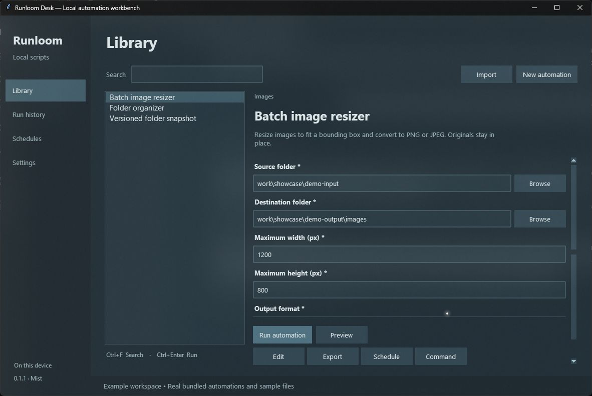
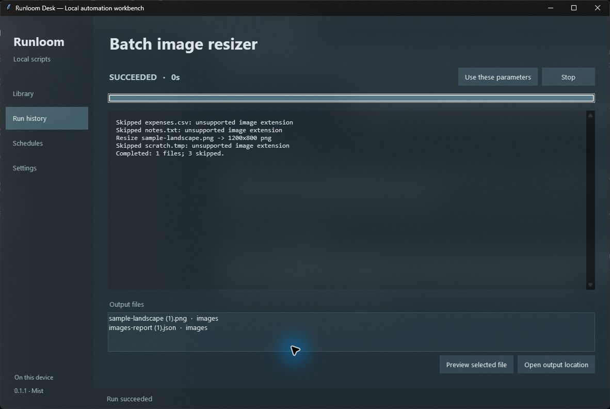

# Runloom Desk

**Your scripts, in reach.** A local Windows workbench for everyday automation: choose a script, fill in a form, run it, and find its logs and output files in one place.

Runloom Desk 0.1.2 includes a desktop app, three working examples and its inspectable Python source. No server, account or cloud service is required. It runs trusted programs with your user permissions; it is not a sandbox.



The screenshot shows the real application using its included example workspace.



## Start on Windows

For the **Windows folder distribution**, extract the complete archive into a writable folder and open **`RunloomDesk.exe`**. Keep `RunloomWorker.exe` and `_internal` alongside it. The desktop and bundled examples include their Python, Tk and Pillow runtime; they do not require a separate Python installation. Your own scripts still need their respective interpreters and dependencies. This build is unsigned and has no installer or automatic updater.

The separate source distribution remains available for inspection and development.

## Run from source

Use Python 3.12 with Tcl/Tk installed and available as `python`. Extract the complete source ZIP into a writable folder, then open a terminal in the extracted `runloom-desk` folder:

```powershell
python --version
python -m pip install -r requirements.txt
python -m runloom
```

After setup, double-click **`launch.cmd`** to open the app. The launcher uses the `python` on your PATH; dependencies must be installed for that interpreter. If you use a virtual environment, activate it before running the launcher or use `.venv\Scripts\python -m runloom` directly.

Pillow 12.3.0 is the only external application package: it supports the bundled image example and generated demo image. The runner, database and desktop widgets use Python's standard library. Installation of dependencies needs network access or a locally supplied compatible wheel. The source ZIP includes neither a Python runtime nor a standalone EXE; use the Windows folder distribution for bundled runtimes.

## Try a complete run

1. Open **Folder organizer** in Library. Its initial source is a small generated demo folder in the app workspace; its destination is a separate demo output folder.
2. Choose **Preview** to inspect planned copies. Return to Library and choose **Run automation** to create them.
3. Watch status and output in Run details. Select an output entry and choose **Open output location**.
4. Open **Run history** to revisit the result. **Use these parameters** loads its inputs into the form for review before another run.

The other examples are **Batch image resizer**, which fits images into a bounding box and converts them to PNG or JPEG, and **Versioned folder snapshot**, which copies a directory into a dated snapshot with exclusion patterns. All three preserve source files, use separate destinations, avoid overwriting existing files and support preview. See [example behavior and restoration](examples/README.md) before using your own folders.

## Add your own automation

Choose **New automation** and edit its JSON manifest, or **Import** a manifest you trust. Set the executable, argument array, working directory and parameter definitions. The app generates text, number, checkbox, selection and file/folder inputs from those definitions.

Use **Command** to inspect the bound executable and arguments. **Edit** changes the definition; **Export** shares its JSON while removing schedules and secret defaults. Export does not copy the script or install its dependencies. Imported files open for review and require a new task ID.

Existing scripts can print ordinary output. An optional JSON-lines protocol adds progress and artifact locations. See the [manifest and protocol guide](docs/manifest.md) for a complete example, quoting rules, PowerShell integration and secret-field limitations.

## Schedules and run control

Select **Schedule** on a task to save the current inputs with a minute interval or daily local time. Review upcoming times or disable a schedule from **Schedules**. The app must remain open; it does not register a Windows service or Task Scheduler job.

Overdue schedules attempt one run when the app resumes or starts again, then advance to a future time. They do not replay every missed interval. Failed launches and overlapping runs are not automatically retried. Daily times use the computer's local timezone. Tasks with secret parameters require manual runs.

**Stop** requests process-tree termination. Timeouts and nonzero exits are recorded in history. Closing the app asks to stop active runs; unfinished records found on the next launch become `interrupted`. Logs retain their last 262,144 characters. Use a script-created report artifact when you need complete output. This app is a noninteractive runner: scripts cannot prompt for terminal input.

## Local data

The default workspace is `.runloom-data` beside the source, or beside `RunloomDesk.exe` in the Windows distribution. It contains `runloom.db`, demo inputs and demo outputs. Open its location from **Settings**, or select another directory at launch:

```powershell
python -m runloom --data-dir "C:\MyAutomationWorkspace"
# Windows distribution:
.\RunloomDesk.exe --data-dir "C:\MyAutomationWorkspace"
```

One app window can own a workspace at a time. You can use a separate workspace for testing. Close the app before backing up the complete workspace directory. Keep the extracted application at a stable path: stored manifests can contain absolute script and working-directory paths. When moving an installation, review those paths in Edit.

The app has no automatic log/history cleanup, updater, background service or credential vault. State is local and unencrypted. Read the [trust model](SECURITY.md) before importing scripts, handling secrets or scheduling file operations.

## Troubleshooting

| Symptom | Check |
| --- | --- |
| `python` is unavailable | Install Python with Tcl/Tk and make the intended interpreter available on PATH. Reopen the terminal. |
| `No module named PIL` | Run `python -m pip install -r requirements.txt` using the same interpreter as the app. |
| Tk fails to load | Run `python -m tkinter`; repair the Python installation's Tcl/Tk component if its test window does not open. |
| Executable or working directory not found | Review Command and Edit. The app does not install external tools or infer a missing project folder. |
| Workspace already open | Use the existing window, close it, or launch with another `--data-dir`. |
| Output location unavailable | The script's reported file was moved, deleted or never created. Check its log and report. |
| Schedule did not run while closed | In-app schedules need the app running. Use an OS scheduler separately if unattended execution after logout is essential. |

## Develop and package

```powershell
python -m unittest discover -s tests -v
python -m compileall -q runloom examples
python build.py
```

`build.py` creates `dist/runloom-desk-0.1.2-source.zip` with stable file ordering and timestamps, excluding caches, test work, runtime data and the output directory. Repeating the build with identical source and Python/zlib tooling produces the same archive. The included Windows CI workflow runs the tests and source build when used in a hosted repository; its presence is not a claim that a remote CI run has occurred.

To build the Windows folder distribution on Windows with Python 3.12:

```powershell
.\build-windows.ps1
```

The script installs the pinned build dependencies and runs PyInstaller, producing `..\runloom-windows\RunloomDesk`. Use `-Python PATH` for a specific interpreter or `-SkipInstall` after preparing dependencies yourself. Distribute that **entire folder**. The two executables share `_internal`; copying only the GUI executable will not work. Frozen binaries are not claimed to be byte-for-byte reproducible or code-signed. Verify a newly built bundle independently, including its worker examples and included notices.

See [architecture and decisions](docs/architecture.md), [comparison with six alternatives](docs/research.md), [contribution guide](CONTRIBUTING.md) and [changelog](CHANGELOG.md).

For executed checks and remaining limitations, see the [verification record](docs/verification.md). To publish your own repository, follow the [GitHub preparation guide](docs/publishing.md).

## License and name

Project source is [MIT licensed](LICENSE); dependency terms are listed in [Third-party software](THIRD_PARTY.md). Runloom Desk is a provisional display name. The internal `runloom` module is unrelated to existing projects using that name; do not install this application with `pip install runloom`. No public repository, download service or registered product name is claimed by this bundle.
