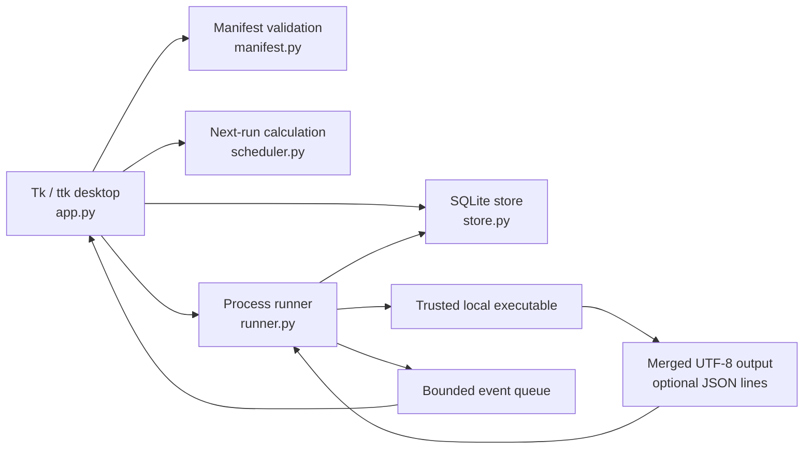

# Architecture and decisions

Runloom Desk is a single-user desktop application. It runs trusted scripts on the same computer and keeps their configuration and history locally. The supported verification target is Windows with Python 3.12 and Tk; the source contains some portable fallbacks but does not claim equivalent cross-platform testing.

## Components



`app.py` owns every Tk widget. It builds forms from manifests, manages navigation, polls the runner queue and dispatches due schedules. The GUI reads durable run snapshots from the store, so dropping stale queue notifications cannot lose the final stored result.

`manifest.py` validates task definitions and input values and performs single-pass placeholder substitution. The command is a list of arguments, not a concatenated shell string. Paths remain ordinary strings until the runner resolves its working directory and executable.

`runner.py` creates a history record before launching a command, then uses a worker thread per run and a separate output reader. Its active-run lock prevents overlapping executions of the same task unless `allow_parallel` is enabled. Stdout and stderr share a pipe. Bounded queues and log retention prevent an ordinary verbose process from growing the desktop's output buffers without limit.

`store.py` serializes access to a SQLite connection with a reentrant lock. WAL mode supports durable local writes. The `tasks` table holds manifest JSON by stable ID; the `runs` table holds timestamped JSON snapshots by generated run ID. Schedules live inside their task record. At startup, unfinished run records are marked `interrupted` because this release does not reconnect to detached processes.

`scheduler.py` is a pure next-time calculation. The desktop checks saved `next_at` values and starts due jobs through the same runner used for manual execution. The desktop dialog exposes intervals and daily times; the calculation module also supports one-time timestamps.

`instance.py` acquires an OS-owned lock in the workspace before opening its database. The launcher refuses a second window for the same workspace; the operating system releases the lock if its owning process exits.

`examples.py` contains the bundled file organizer, image resizer and folder snapshot commands. They can also run directly with `python -m runloom.examples`. Their manifests use the same runner and protocol as user commands.

The Windows folder build has two entry points: `RunloomDesk.exe` for the GUI and `RunloomWorker.exe` for the bundled example commands. They share an `_internal` runtime directory. The GUI executable is not used as a Python interpreter. In frozen mode, `{python}` resolves an external Python on PATH for custom scripts; bundled examples point to the worker explicitly. Resource files live under `_internal`, while the default writable workspace lives beside the executables.

## Execution lifecycle

```text
validated inputs → queued → running → succeeded | failed | cancelled | timed_out
                     └──────────────→ failed | cancelled
unfinished record on next startup → interrupted
```

A zero exit code means `succeeded`; nonzero exit or a launch error means `failed`. Progress is script-reported and independent of success. Cancellation and elapsed time limits request process-tree termination. On Windows, a Job Object with kill-on-close tracks child processes; termination also has a fallback path. This is lifecycle management, not a security boundary: already completed external side effects remain.

Run snapshots include task name/ID, validated values with secret fields masked, redacted command, working directory, timestamps, status, exit code, log tail, progress and artifact paths. The database is not encrypted. Artifact bytes are never stored in SQLite.

## Decisions and tradeoffs

| Decision | Why | Cost / boundary |
| --- | --- | --- |
| Python 3.12 + Tk/ttk | Available Windows desktop stack, standard-library forms and process APIs, small source distribution. | Source launch requires an interpreter with Tk; the Windows build bundles these runtimes. |
| SQLite + JSON records | Local transactions with little infrastructure; preserves manifest fields without extra tables. | No multi-user collaboration, database-level querying of all JSON attributes or migration framework yet. |
| Manifest-generated forms | Existing CLI scripts can be integrated without adopting an SDK. | Parameter names and CLI behavior must be described correctly by the author. |
| Shell-free argument list | Preserves parameter boundaries and avoids accidental shell interpretation. | Explicit shells and unsafe scripts remain the user's responsibility. |
| Optional JSON-lines output | Ordinary scripts work immediately; authors can add progress and artifacts incrementally. | Not an interactive terminal and not a full structured event archive. |
| In-process scheduling | No service install, elevated privileges or OS-specific job registration. | App must remain open; no execution while logged out or after reboot unless the user starts it. |
| Coalesce overdue schedules | Avoids a burst of old work after sleep or downtime. | Missed periods are not replayed; failed starts and overlap rejections have no automatic retry. |
| Source ZIP and Windows folder build | Source remains inspectable; the frozen GUI and example worker provide a launch path without separately installing Python. | Source ZIP needs Python and Pillow; the frozen build is larger and requires its complete runtime folder. No signing or updater. |

## State, concurrency and recovery

The default workspace is `.runloom-data` under the source project root or beside the frozen executables. `--data-dir PATH` selects another workspace. It contains the database, generated demo inputs and example outputs. Keep source and workspace backups separate. Close the app before copying a workspace database so SQLite can finish its WAL writes.

The application launcher enforces one application process per workspace. Runner overlap protection applies within that process, not across separate workspaces or a script launched externally. Run recovery records that the previous application stopped; it does not prove that every external effect or detached process stopped.

Schedules use wall-clock timestamps and the computer's local timezone; execution timeouts use a monotonic timer. Changing the system clock or timezone can change schedule behavior. No timezone picker, exact-once execution guarantee, missed-run queue or retry policy is provided.

## Extension points

Adding a new local automation normally needs only a manifest and script. Add protocol output only if useful. A future OS scheduler adapter should preserve the same validated inputs and history model while explicitly defining credential handling, missed-run behavior and process ownership. Changes to the frozen distribution require independent smoke tests of the desktop, worker, dependencies and included license notices; passing source tests alone does not establish that a packaged executable works.
